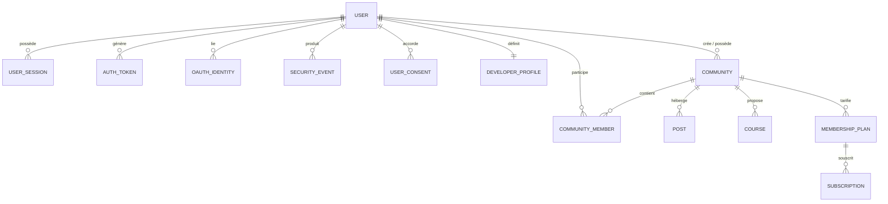

# KODINGA DATA MODEL SPECIFICATION

## 1. Abstractions Communes (`common`)

### BaseModel
Classe abstraite servant de fondation pour l'ensemble des entités de données du système :
- `id` : `UUIDField(primary_key=True, default=uuid4, editable=False)`
- `created_at` : `DateTimeField(auto_now_add=True, db_index=True)`
- `updated_at` : `DateTimeField(auto_now=True)`

### SoftDeletableModel (Optionnel)
- `deleted_at` : `DateTimeField(null=True, blank=True, db_index=True)`
- `is_deleted` : `BooleanField(default=False)`

---

## 2. Domaine Authentification & Comptes (`apps/accounts`)

### 1. User
Modèle utilisateur personnalisé (`AUTH_USER_MODEL`) :
- `id` : `UUIDField(primary_key=True, default=uuid4)`
- `email` : `EmailField(unique=True, db_index=True)` (normalisé en minuscules)
- `username` : `CharField(max_length=50, unique=True, db_index=True)`
- `first_name` : `CharField(max_length=150, blank=True)`
- `last_name` : `CharField(max_length=150, blank=True)`
- `password` : `CharField(max_length=128)` (hash PBKDF2/Argon2)
- `is_active` : `BooleanField(default=True)`
- `is_staff` : `BooleanField(default=False)`
- `is_superuser` : `BooleanField(default=False)`
- `email_verified_at` : `DateTimeField(null=True, blank=True)`
- `preferred_language` : `CharField(max_length=10, default='fr')`
- `timezone` : `CharField(max_length=50, default='UTC')`
- `date_joined` : `DateTimeField(auto_now_add=True)`
- `last_login` : `DateTimeField(null=True, blank=True)`
- `created_at` / `updated_at`

### 2. UserSession
Gestion des sessions et appareils connectés avec traçabilité et révocation :
- `id` : `UUIDField(primary_key=True)`
- `user` : `ForeignKey(User, on_delete=CASCADE, related_name='sessions')`
- `session_identifier` : `CharField(max_length=255, unique=True, db_index=True)`
- `refresh_token_identifier` : `CharField(max_length=255, unique=True, db_index=True)` (JTI hash)
- `device_name` : `CharField(max_length=255, blank=True)`
- `user_agent` : `TextField(blank=True)`
- `ip_address` : `GenericIPAddressField(null=True, blank=True)`
- `last_seen_at` : `DateTimeField(auto_now=True)`
- `expires_at` : `DateTimeField()`
- `revoked_at` : `DateTimeField(null=True, blank=True)`

### 3. AuthToken
Jetons cryptographiques à usage unique (vérification email, reset password, etc.) :
- `id` : `UUIDField(primary_key=True)`
- `user` : `ForeignKey(User, on_delete=CASCADE, related_name='auth_tokens')`
- `purpose` : `CharField(max_length=50)` (`email_verification`, `password_reset`, `email_change`, `account_deletion`)
- `token_hash` : `CharField(max_length=64, db_index=True)` (SHA-256 du token aléatoire)
- `expires_at` : `DateTimeField()`
- `consumed_at` : `DateTimeField(null=True, blank=True)`
- `created_at`

### 4. OAuthIdentity
Liaisons avec les fournisseurs tiers (Google, GitHub) :
- `id` : `UUIDField(primary_key=True)`
- `user` : `ForeignKey(User, on_delete=CASCADE, related_name='oauth_identities')`
- `provider` : `CharField(max_length=50)` (`google`, `github`)
- `provider_user_id` : `CharField(max_length=255)`
- `provider_email` : `CharField(max_length=255, blank=True)`
- Contrainte d'unicité : `unique_together = ('provider', 'provider_user_id')`

### 5. UserConsent
Traçabilité des consentements RGPD et CGU :
- `id` : `UUIDField(primary_key=True)`
- `user` : `ForeignKey(User, on_delete=CASCADE, related_name='consents')`
- `consent_type` : `CharField(max_length=100)` (`terms_of_service`, `privacy_policy`, `marketing`)
- `policy_version` : `CharField(max_length=50)`
- `granted` : `BooleanField(default=True)`
- `recorded_at` : `DateTimeField(auto_now_add=True)`

### 6. SecurityEvent
Journal d'audit de sécurité :
- `id` : `UUIDField(primary_key=True)`
- `user` : `ForeignKey(User, on_delete=SET_NULL, null=True, related_name='security_events')`
- `event_type` : `CharField(max_length=100, db_index=True)` (`login_success`, `login_failed`, `password_changed`, `session_revoked`, `email_verified`, `oauth_linked`, `suspicious_activity`)
- `ip_address` : `GenericIPAddressField(null=True, blank=True)`
- `user_agent` : `TextField(blank=True)`
- `metadata` : `JSONField(default=dict, blank=True)`
- `created_at` : `DateTimeField(auto_now_add=True, db_index=True)`

---

## 3. Schéma Global des Domaines Associés

