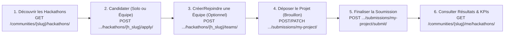
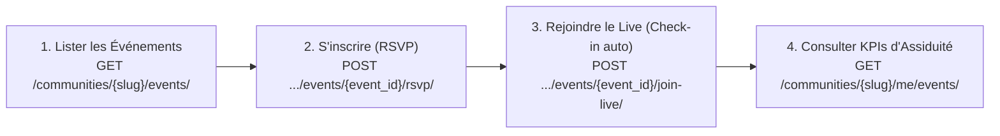
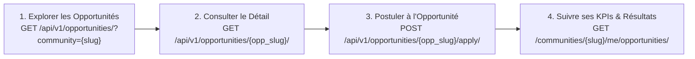
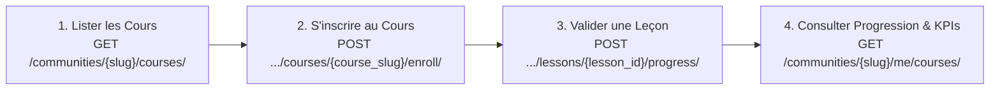

# Guide d'Implémentation Frontend — KPIs & Activités d'un Membre par Module (Événements, Hackathons, Opportunités, Formations)

Ce document est destiné au **Développeur Frontend**. Il détaille l'architecture complète des API Backend permettant à un **membre d'une communauté** (ou sur l'ensemble de la plateforme Kodinga) de :
1. **Exécuter ses actions** dans chaque module (**Événements**, **Hackathons**, **Opportunités**, **Formations / Classroom**).
2. **Récupérer ses KPIs de performance** (participations, taux de réussite, taux d'échec, victoires/podiums, présences/absences, candidatures acceptées/refusées, progression par module).

---

## 1. Architecture Globale & Filtrage par Communauté

Toutes les réponses du backend utilisent l'enveloppe standardisée Kodinga :
```json
{
  "success": true,
  "data": { ... },
  "meta": {}
}
```
> **Authentification requise** : Tous les endpoints KPIs membre nécessitent le header `Authorization: Bearer <access_token>`.

### Trois façons d'interroger les KPIs du membre connecté

Le backend expose **3 conventions d'URL équivalentes** pour s'adapter à toutes les vues du Frontend (Dashboard Global du profil vs Dashboard interne à une Communauté) :

| Contexte UI | Endpoints Principaux (`/analytics/member/...`) | Alias Profil (`/users/me/...`) | Route dédiée Communauté (`/communities/<slug>/me/...`) |
| :--- | :--- | :--- | :--- |
| **1. Vue d'ensemble (Dashboard Unifié)** | `GET /api/v1/analytics/member/dashboard/` | `GET /api/v1/users/me/dashboard/` | `GET /api/v1/communities/<slug>/me/dashboard/` |
| **2. Module Hackathons** | `GET /api/v1/analytics/member/hackathons/` | `GET /api/v1/users/me/hackathons/` | `GET /api/v1/communities/<slug>/me/hackathons/` |
| **3. Module Événements** | `GET /api/v1/analytics/member/events/` | `GET /api/v1/users/me/events/` | `GET /api/v1/communities/<slug>/me/events/` |
| **4. Module Opportunités** | `GET /api/v1/analytics/member/opportunities/` | `GET /api/v1/users/me/opportunities/` | `GET /api/v1/communities/<slug>/me/opportunities/` |
| **5. Module Formations (Courses)** | `GET /api/v1/analytics/member/courses/` | `GET /api/v1/users/me/courses/` | `GET /api/v1/communities/<slug>/me/courses/` |

> **Astuce Query Parameter (`?community=`)** :
> Sur tous les endpoints `/api/v1/analytics/member/...` et `/api/v1/users/me/...`, vous pouvez également passer `?community=<slug_ou_uuid>` (ex: `GET /api/v1/analytics/member/dashboard/?community=python-dakar`) pour filtrer dynamiquement les KPIs uniquement sur cette communauté !

---

## 2. Vue d'Ensemble : Tableau de Bord Unifié du Membre

Idéal pour la page **"Mon Espace Membre / Mes Statistiques"** dans une communauté ou sur le profil global. Cet endpoint agrège en un seul appel les **4 blocs de KPIs** ainsi que les **3 éléments les plus récents** (`highlights`) de chaque module.

### Requête
- **Global** : `GET /api/v1/analytics/member/dashboard/`
- **Par communauté** : `GET /api/v1/communities/{community_slug}/me/dashboard/` (ou `GET /api/v1/analytics/member/dashboard/?community={community_slug}`)

### Réponse (`200 OK`)
```json
{
  "success": true,
  "data": {
    "kpis": {
      "hackathons": {
        "total_participated": 3,
        "successful_count": 2,
        "failed_count": 1,
        "in_progress_count": 0,
        "prizes_won_count": 1,
        "submissions_count": 2,
        "success_rate": 66.7
      },
      "events": {
        "total_registered": 5,
        "attended_count": 3,
        "upcoming_count": 1,
        "completed_count": 4,
        "missed_count": 1,
        "attendance_rate": 75.0
      },
      "opportunities": {
        "total_applied": 4,
        "accepted_count": 1,
        "rejected_count": 1,
        "in_review_count": 2,
        "success_rate": 50.0
      },
      "courses": {
        "total_enrolled": 2,
        "completed_count": 1,
        "in_progress_count": 1,
        "total_lessons_completed": 14,
        "average_progress_percent": 87.5
      }
    },
    "highlights": {
      "recent_hackathons": [ /* Top 3 hackathons du membre */ ],
      "upcoming_or_recent_events": [ /* Top 3 événements du membre */ ],
      "recent_opportunity_applications": [ /* Top 3 candidatures opportunités */ ],
      "active_courses": [ /* Top 3 formations avec progression par module */ ]
    }
  }
}
```

---

## 3. Module 1 : Hackathons (Flux d'Actions & KPIs de Réussite/Échec)

### 3.1. Flux d'actions du membre (Qui alimente les KPIs)



1. **Lister les hackathons d'une communauté** : `GET /api/v1/communities/{slug}/hackathons/`
2. **Postuler / S'inscrire à un hackathon** : `POST /api/v1/communities/{slug}/hackathons/{hackathon_slug}/apply/`
   - Payload : `{"participation_mode": "individual" | "team", "motivation": "...", "skills": ["Python", "React"]}`
3. **Vérifier sa candidature** : `GET /api/v1/communities/{slug}/hackathons/{hackathon_slug}/my-application/`
4. **Gérer son équipe (si mode équipe)** :
   - Créer une équipe : `POST /api/v1/communities/{slug}/hackathons/{hackathon_slug}/teams/`
   - Inviter un membre : `POST /api/v1/communities/{slug}/hackathons/{hackathon_slug}/teams/{team_id}/invite/`
   - Répondre à une invitation : `POST /api/v1/communities/{slug}/hackathons/{hackathon_slug}/teams/respond-invite/`
5. **Créer / Modifier la soumission du projet** : `POST` ou `PATCH /api/v1/communities/{slug}/hackathons/{hackathon_slug}/submissions/my-project/`
6. **Finaliser la soumission avant la deadline** : `POST /api/v1/communities/{slug}/hackathons/{hackathon_slug}/submissions/my-project/submit/`

### 3.2. Endpoint KPIs & Résultats Hackathons du Membre

- **URL Globale** : `GET /api/v1/analytics/member/hackathons/` (ou `?community={slug}`)
- **URL Communauté** : `GET /api/v1/communities/{slug}/me/hackathons/`

#### Logique métier des états (`member_result`) et du Taux de Réussite (`success_rate`)
Chaque hackathon auquel le membre a participé (via candidature individuelle, appartenance active à une équipe ou soumission) reçoit un statut consolidé `member_result` :

| Valeur `member_result` | Catégorie KPI | Signification Métier / UI Badge recommandé |
| :--- | :--- | :--- |
| `"won"` | **Réussite (`successful_count`)** | Lauréat d'un prix (`prizes_won` non vide) ou classé **1er** (`rank == 1`). Badge Or / Trophée. |
| `"podium"` | **Réussite (`successful_count`)** | Classé dans le **Top 3** (`rank <= 3`). Badge Podium. |
| `"submitted"` | **Réussite (`successful_count`)** | Projet finalisé et soumis avec succès dans les temps (`is_final = true` ou statut `submitted` / `accepted`). Badge Vert. |
| `"in_progress"` | **En cours (`in_progress_count`)** | Hackathon actif, le membre prépare son projet. Badge Bleu. |
| `"pending"` | **En cours (`in_progress_count`)** | Candidature en attente de validation (`pending` / `waitlisted`). Badge Jaune. |
| `"rejected"` | **Échec (`failed_count`)** | Candidature refusée par les organisateurs. Badge Rouge. |
| `"withdrawn"` | **Échec (`failed_count`)** | Candidature retirée / abandon par le membre. Badge Gris. |
| `"failed"` | **Échec (`failed_count`)** | Hackathon terminé sans soumission finale déposée, ou soumission disqualifiée. Badge Rouge. |

- **Formule `success_rate`** : `(successful_count / (successful_count + failed_count)) * 100` (les hackathons `"in_progress"` ou `"pending"` ne pénalisent pas le taux de réussite).

#### Exemple de réponse (`GET /api/v1/communities/{slug}/me/hackathons/`)
```json
{
  "success": true,
  "data": {
    "kpis": {
      "total_participated": 3,
      "successful_count": 2,
      "failed_count": 1,
      "in_progress_count": 0,
      "prizes_won_count": 1,
      "submissions_count": 2,
      "success_rate": 66.7
    },
    "hackathons": [
      {
        "id": "b7c0e56a-92a1-4c22-8f1a-123456789abc",
        "title": "AI Hackathon 2026",
        "slug": "ai-hackathon-2026",
        "short_description": "Construisez la prochaine génération d'agents IA",
        "cover_image_url": "https://...",
        "status": "completed",
        "status_display": "Terminé",
        "format": "hybrid",
        "start_time": "2026-10-10T09:00:00Z",
        "submission_deadline": "2026-10-15T18:00:00Z",
        "community": {
          "id": "a1b2c3d4-...",
          "name": "Python Dakar Community",
          "slug": "python-dakar",
          "logo_url": "https://..."
        },
        "participation_mode": "individual",
        "application": {
          "id": "c8d9e0f1-...",
          "status": "accepted",
          "status_display": "Acceptée",
          "participation_mode": "individual",
          "applied_at": "2026-10-01T12:00:00Z"
        },
        "team": null,
        "submission": {
          "id": "d4e5f6a7-...",
          "title": "AI Voice Assistant",
          "slug": "ai-voice-assistant",
          "tagline": "Autonomous Voice Assistant",
          "status": "submitted",
          "status_display": "Soumis",
          "is_final": true,
          "submitted_at": "2026-10-14T15:30:00Z",
          "total_score": "94.50",
          "rank": 1,
          "prizes_won": [
            {
              "id": "e1f2a3b4-...",
              "title": "1er Prix - Vainqueur",
              "rank": 1,
              "reward_amount": "1000000.00",
              "reward_currency": "XOF",
              "non_cash_reward": "Incubation + Crédits Cloud"
            }
          ]
        },
        "member_result": "won",
        "is_winner": true,
        "is_podium": true
      }
    ]
  }
}
```

---

## 4. Module 2 : Événements (Flux d'Actions & KPIs d'Assiduité)

### 4.1. Flux d'actions du membre



1. **Lister les événements de la communauté** : `GET /api/v1/communities/{slug}/events/`
2. **S'inscrire / Modifier son RSVP** : `POST /api/v1/communities/{slug}/events/{event_id}/rsvp/`
   - Payload : `{"status": "attending" | "interested" | "declined"}`
3. **Rejoindre la salle LiveKit (Événement en ligne)** : `POST /api/v1/communities/{slug}/events/{event_id}/join-live/`
   - Retourne le token LiveKit et enregistre automatiquement la présence (`checked_in_at`).
4. **Télécharger l'invitation calendrier (.ics)** : `GET /api/v1/communities/{slug}/events/{event_id}/calendar.ics`

### 4.2. Endpoint KPIs & Historique Événements du Membre

- **URL Globale** : `GET /api/v1/analytics/member/events/` (ou `?community={slug}`)
- **URL Communauté** : `GET /api/v1/communities/{slug}/me/events/`

#### Logique métier des KPIs d'Assiduité
- `total_registered` : Nombre total d'événements auxquels le membre a répondu (RSVP).
- `upcoming_count` : Événements à venir ou actuellement en direct (`is_upcoming` ou `is_in_progress`) où le membre est inscrit (`status != "declined"`).
- `completed_count` : Événements passés/terminés.
- `attended_count` (**Réussite / Présence**) : Événements terminés auxquels le membre a assisté (`is_checked_in == true` ou statut `attending`).
- `missed_count` (**Échec / Absence**) : Événements terminés que le membre a déclinés ou manqués.
- `attendance_rate` : `(attended_count / completed_count) * 100`.

#### Exemple de réponse (`GET /api/v1/communities/{slug}/me/events/`)
```json
{
  "success": true,
  "data": {
    "kpis": {
      "total_registered": 3,
      "attended_count": 1,
      "upcoming_count": 1,
      "completed_count": 2,
      "missed_count": 1,
      "attendance_rate": 50.0
    },
    "events": [
      {
        "id": "7f8e9d0c-...",
        "title": "Next.js Live Coding",
        "slug": "nextjs-live-coding",
        "description": "Session live sur Next.js App Router",
        "cover_image_url": "https://...",
        "event_type": "live_stream",
        "event_type_display": "Live Stream",
        "format": "livekit",
        "format_display": "LiveKit (Intégré)",
        "status": "completed",
        "status_display": "Terminé",
        "start_time": "2026-10-28T18:00:00Z",
        "end_time": "2026-10-28T20:00:00Z",
        "timezone": "UTC",
        "is_free": true,
        "price": "0.00",
        "community": {
          "id": "a1b2c3d4-...",
          "name": "Python Dakar Community",
          "slug": "python-dakar",
          "logo_url": "https://..."
        },
        "rsvp_status": "attending",
        "rsvp_status_display": "Participe",
        "registered_at": "2026-10-25T10:00:00Z",
        "checked_in_at": "2026-10-28T18:05:00Z",
        "is_checked_in": true,
        "is_upcoming": false,
        "is_in_progress": false,
        "is_completed": true
      }
    ]
  }
}
```

---

## 5. Module 3 : Opportunités (Flux de Candidature & KPIs de Conversion)

### 5.1. Flux d'actions du membre



1. **Lister les opportunités (emploi, freelance, stage, bounty)** : `GET /api/v1/opportunities/` (supporte les filtres `?community=<slug>`, `?opportunity_type=`, `?workplace_type=`, `?experience_level=`)
2. **Voir le détail d'une opportunité** : `GET /api/v1/opportunities/{slug}/`
3. **Postuler à une opportunité** : `POST /api/v1/opportunities/{slug}/apply/`
   - Payload :
     ```json
     {
       "cover_letter": "Bonjour, voici ma candidature...",
       "cv_url": "https://...",
       "portfolio_url": "https://github.com/..."
     }
     ```

### 5.2. Endpoint KPIs & Résultats des Candidatures Opportunités

- **URL Globale** : `GET /api/v1/analytics/member/opportunities/` (ou `?community={slug}`)
- **URL Communauté** : `GET /api/v1/communities/{slug}/me/opportunities/`

#### Logique métier des Résultats de Candidature
Chaque candidature possède 3 drapeaux booléens prêts à l'emploi pour le Frontend :
- `is_successful: true` (`status == "accepted"`) -> Comptabilisé dans `accepted_count` (**Réussite**).
- `is_failed: true` (`status == "rejected"`) -> Comptabilisé dans `rejected_count` (**Échec**).
- `is_in_review: true` (`status` dans `["pending", "reviewing", "shortlisted"]`) -> Comptabilisé dans `in_review_count` (**En cours d'évaluation**).
- **Formule `success_rate`** : `(accepted_count / (accepted_count + rejected_count)) * 100` (calculé sur les candidatures ayant reçu une décision finale).

#### Exemple de réponse (`GET /api/v1/communities/{slug}/me/opportunities/`)
```json
{
  "success": true,
  "data": {
    "kpis": {
      "total_applied": 3,
      "accepted_count": 1,
      "rejected_count": 1,
      "in_review_count": 1,
      "success_rate": 50.0
    },
    "applications": [
      {
        "id": "9a8b7c6d-...",
        "status": "accepted",
        "status_display": "Acceptée",
        "is_successful": true,
        "is_failed": false,
        "is_in_review": false,
        "applied_at": "2026-10-12T14:20:00Z",
        "updated_at": "2026-10-20T09:15:00Z",
        "cv_url": "https://...",
        "portfolio_url": "https://...",
        "opportunity": {
          "id": "1a2b3c4d-...",
          "title": "Senior Backend Python Engineer",
          "slug": "senior-backend-python",
          "company_name": "Fintech Corp",
          "company_logo_url": "https://...",
          "opportunity_type": "full_time",
          "opportunity_type_display": "CDI / Temps plein",
          "workplace_type": "remote",
          "workplace_type_display": "Télétravail",
          "experience_level": "senior",
          "experience_level_display": "Senior",
          "location": "Dakar, Sénégal",
          "salary_min": "2000000.00",
          "salary_max": "2500000.00",
          "currency": "XOF",
          "is_salary_visible": true,
          "status": "open",
          "deadline": "2026-11-30T23:59:59Z",
          "community": {
            "id": "a1b2c3d4-...",
            "name": "Python Dakar Community",
            "slug": "python-dakar",
            "logo_url": "https://..."
          }
        }
      }
    ]
  }
}
```

---

## 6. Module 4 : Formations / Classroom (Flux d'Apprentissage & KPIs par Module)

### 6.1. Flux d'actions du membre



1. **Lister les formations d'une communauté** : `GET /api/v1/communities/{slug}/courses/`
2. **S'inscrire à une formation** : `POST /api/v1/communities/{slug}/courses/{course_slug}/enroll/`
3. **Marquer une leçon comme complétée / mettre à jour la progression vidéo** :
   - `POST /api/v1/communities/{slug}/courses/{course_slug}/lessons/{lesson_id}/progress/`
   - Payload : `{"is_completed": true, "last_watched_second": 420}`

### 6.2. Endpoint KPIs & Progression par Module des Formations

- **URL Globale** : `GET /api/v1/analytics/member/courses/` (ou `?community={slug}`)
- **URL Communauté** : `GET /api/v1/communities/{slug}/me/courses/`

#### Exemple de réponse (`GET /api/v1/communities/{slug}/me/courses/`)
```json
{
  "success": true,
  "data": {
    "kpis": {
      "total_enrolled": 1,
      "completed_count": 0,
      "in_progress_count": 1,
      "total_lessons_completed": 5,
      "average_progress_percent": 83.3
    },
    "courses": [
      {
        "id": "5e6f7a8b-...",
        "title": "Architecture Microservices & Event-Driven",
        "slug": "microservices-event-driven",
        "description": "Maîtrisez DDD, CQRS et Kafka",
        "thumbnail_url": "https://...",
        "level": "intermediate",
        "level_display": "Intermédiaire",
        "is_free_for_members": true,
        "price": "0.00",
        "duration_seconds": 7200,
        "community": {
          "id": "a1b2c3d4-...",
          "name": "Python Dakar Community",
          "slug": "python-dakar",
          "logo_url": "https://..."
        },
        "enrolled_at": "2026-10-01T08:00:00Z",
        "completed_at": null,
        "last_accessed_at": "2026-10-29T19:00:00Z",
        "is_completed": false,
        "overall_progress_percent": 83.3,
        "total_lessons": 6,
        "completed_lessons": 5,
        "total_modules": 2,
        "completed_modules": 1,
        "modules_progress": [
          {
            "module_id": "11111111-...",
            "title": "Module 1: Fondations DDD & Event Sourcing",
            "description": "",
            "order": 1,
            "total_lessons": 4,
            "completed_lessons": 3,
            "progress_percent": 75.0,
            "is_completed": false
          },
          {
            "module_id": "22222222-...",
            "title": "Module 2: Apache Kafka & CQRS",
            "description": "",
            "order": 2,
            "total_lessons": 2,
            "completed_lessons": 2,
            "progress_percent": 100.0,
            "is_completed": true
          }
        ]
      }
    ]
  }
}
```

---

## 7. Interfaces TypeScript & Service d'Intégration Frontend (Prêt à copier)

```typescript
// types/member-kpis.ts

export interface CommunitySummary {
  id: string;
  name: string;
  slug: string;
  logo_url: string;
}

// 1. HACKATHONS
export type HackathonMemberResult =
  | "won"
  | "podium"
  | "submitted"
  | "in_progress"
  | "pending"
  | "rejected"
  | "withdrawn"
  | "failed";

export interface MemberHackathonKPIs {
  total_participated: number;
  successful_count: number;
  failed_count: number;
  in_progress_count: number;
  prizes_won_count: number;
  submissions_count: number;
  success_rate: number; // 0 - 100
}

export interface MemberHackathonItem {
  id: string;
  title: string;
  slug: string;
  short_description: string;
  cover_image_url: string;
  status: string;
  status_display: string;
  format: string;
  start_time: string | null;
  submission_deadline: string | null;
  community: CommunitySummary | null;
  participation_mode: "individual" | "team";
  application: {
    id: string;
    status: string;
    status_display: string;
    participation_mode: string;
    applied_at: string;
  } | null;
  team: {
    id: string;
    name: string;
    role: string;
    is_leader: boolean;
  } | null;
  submission: {
    id: string;
    title: string;
    slug: string;
    tagline: string;
    status: string;
    status_display: string;
    is_final: boolean;
    submitted_at: string | null;
    total_score: string | null;
    rank: number | null;
    prizes_won: Array<{
      id: string;
      title: string;
      rank: number;
      reward_amount: string | null;
      reward_currency: string;
      non_cash_reward: string;
    }>;
  } | null;
  member_result: HackathonMemberResult;
  is_winner: boolean;
  is_podium: boolean;
}

// 2. EVENTS
export interface MemberEventKPIs {
  total_registered: number;
  attended_count: number;
  upcoming_count: number;
  completed_count: number;
  missed_count: number;
  attendance_rate: number; // 0 - 100
}

export interface MemberEventItem {
  id: string;
  title: string;
  slug: string;
  description: string;
  cover_image_url: string;
  event_type: string;
  event_type_display: string;
  format: string;
  format_display: string;
  status: string;
  status_display: string;
  start_time: string;
  end_time: string;
  timezone: string;
  is_free: boolean;
  price: string;
  community: CommunitySummary | null;
  rsvp_status: "attending" | "interested" | "declined";
  rsvp_status_display: string;
  registered_at: string;
  checked_in_at: string | null;
  is_checked_in: boolean;
  is_upcoming: boolean;
  is_in_progress: boolean;
  is_completed: boolean;
}

// 3. OPPORTUNITIES
export interface MemberOpportunityKPIs {
  total_applied: number;
  accepted_count: number;
  rejected_count: number;
  in_review_count: number;
  success_rate: number; // 0 - 100
}

export interface MemberOpportunityApplicationItem {
  id: string;
  status: "pending" | "reviewing" | "shortlisted" | "accepted" | "rejected";
  status_display: string;
  is_successful: boolean;
  is_failed: boolean;
  is_in_review: boolean;
  applied_at: string;
  updated_at: string;
  cv_url: string;
  portfolio_url: string;
  opportunity: {
    id: string;
    title: string;
    slug: string;
    company_name: string;
    company_logo_url: string;
    opportunity_type: string;
    opportunity_type_display: string;
    workplace_type: string;
    workplace_type_display: string;
    experience_level: string;
    experience_level_display: string;
    location: string;
    salary_min: string | null;
    salary_max: string | null;
    currency: string;
    is_salary_visible: boolean;
    status: string;
    deadline: string | null;
    community: CommunitySummary | null;
  };
}

// 4. COURSES
export interface MemberCourseKPIs {
  total_enrolled: number;
  completed_count: number;
  in_progress_count: number;
  total_lessons_completed: number;
  average_progress_percent: number; // 0 - 100
}

export interface CourseModuleProgress {
  module_id: string;
  title: string;
  description: string;
  order: number;
  total_lessons: number;
  completed_lessons: number;
  progress_percent: number;
  is_completed: boolean;
}

export interface MemberCourseItem {
  id: string;
  title: string;
  slug: string;
  description: string;
  thumbnail_url: string;
  level: "beginner" | "intermediate" | "advanced" | "all_levels";
  level_display: string;
  is_free_for_members: boolean;
  price: string;
  duration_seconds: number;
  community: CommunitySummary | null;
  enrolled_at: string;
  completed_at: string | null;
  last_accessed_at: string | null;
  is_completed: boolean;
  overall_progress_percent: number;
  total_lessons: number;
  completed_lessons: number;
  total_modules: number;
  completed_modules: number;
  modules_progress: CourseModuleProgress[];
}

// 5. UNIFIED DASHBOARD
export interface MemberActivityDashboardPayload {
  kpis: {
    hackathons: MemberHackathonKPIs;
    events: MemberEventKPIs;
    opportunities: MemberOpportunityKPIs;
    courses: MemberCourseKPIs;
  };
  highlights: {
    recent_hackathons: MemberHackathonItem[];
    upcoming_or_recent_events: MemberEventItem[];
    recent_opportunity_applications: MemberOpportunityApplicationItem[];
    active_courses: MemberCourseItem[];
  };
}
```

### Fonctions d'appel API (`services/memberActivityApi.ts`)

```typescript
// services/memberActivityApi.ts

const buildUrl = (basePath: string, communitySlugOrId?: string) => {
  if (!communitySlugOrId) return basePath;
  const params = new URLSearchParams({ community: communitySlugOrId });
  return `${basePath}?${params.toString()}`;
};

export const memberActivityApi = {
  /**
   * Récupère le dashboard unifié (KPIs + 3 highlights récents par module).
   * @param community Optionnel : slug ou UUID de la communauté pour filtrer uniquement sur celle-ci
   */
  getDashboard: (community?: string) =>
    apiClient.get<{ data: MemberActivityDashboardPayload }>(
      buildUrl("/api/v1/analytics/member/dashboard/", community)
    ),

  /**
   * Récupère les KPIs et la liste complète des hackathons du membre.
   */
  getHackathons: (community?: string) =>
    apiClient.get<{
      data: { kpis: MemberHackathonKPIs; hackathons: MemberHackathonItem[] };
    }>(buildUrl("/api/v1/analytics/member/hackathons/", community)),

  /**
   * Récupère les KPIs d'assiduité et la liste complète des événements du membre.
   */
  getEvents: (community?: string) =>
    apiClient.get<{
      data: { kpis: MemberEventKPIs; events: MemberEventItem[] };
    }>(buildUrl("/api/v1/analytics/member/events/", community)),

  /**
   * Récupère les KPIs de réussite/échec et les candidatures aux opportunités du membre.
   */
  getOpportunities: (community?: string) =>
    apiClient.get<{
      data: {
        kpis: MemberOpportunityKPIs;
        applications: MemberOpportunityApplicationItem[];
      };
    }>(buildUrl("/api/v1/analytics/member/opportunities/", community)),

  /**
   * Récupère les KPIs de formation et la progression module par module.
   */
  getCourses: (community?: string) =>
    apiClient.get<{
      data: { kpis: MemberCourseKPIs; courses: MemberCourseItem[] };
    }>(buildUrl("/api/v1/analytics/member/courses/", community)),
};
```

