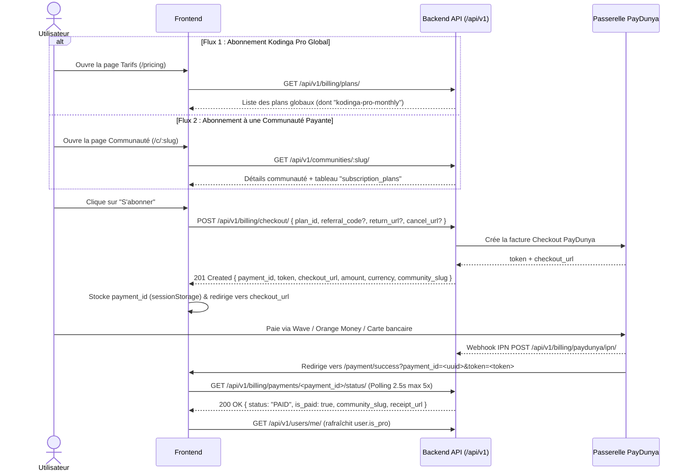

# Guide d'Intégration Frontend — Flux d'Abonnement PayDunya (Utilisateur Pro & Communauté Payante)

Ce document décrit l'intégralité des contrats d'API et le flux d'actions à implémenter côté **Frontend** pour :
1. **L'abonnement Kodinga Pro** (passage d'un utilisateur `Hobby` à `Pro` via abonnement mensuel, annuel ou à vie).
2. **L'abonnement d'un membre à une Communauté Payante** (souscription au pass mensuel d'une communauté, déblocage automatique de l'accès, et tableau de bord financier du créateur Pro).

---

## 1. Principes Clés & Sécurité Backend

1. **Enveloppe de réponse standardisée** :
   Toutes les réponses du backend suivent le format :
   ```json
   {
     "success": true,
     "message": "...",
     "data": { ... }
   }
   ```
2. **Autorité stricte du serveur sur les prix** :
   Le frontend n'envoie **jamais** de prix lors du checkout, uniquement le `plan_id` (UUID). Le tarif mensuel Pro (par défaut `5 000 FCFA/mois`) est dynamique et piloté par le Superadmin.
3. **Injection automatique de `payment_id` dans les URLs de retour** :
   Lors de l'appel à `POST /api/v1/billing/checkout/`, le backend ajoute automatiquement `?payment_id=<uuid>` aux URLs `return_url` (`/payment/success`) et `cancel_url` (`/payment/cancel`).
4. **Double confirmation (Webhook IPN + Polling actif de secours)** :
   - En production, PayDunya notifie le backend en arrière-plan via `POST /api/v1/billing/paydunya/ipn/`.
   - Sur la page `/payment/success`, lorsque le frontend appelle `GET /api/v1/billing/payments/<payment_id>/status/`, si le paiement est encore `PENDING` (ex: en local sans tunnel ngrok ou latence réseau), **le backend interroge directement PayDunya en temps réel**, valide la transaction et active l'abonnement immédiatement.

---

## 2. Vue d'Ensemble du Flux d'Abonnement



---

## 3. FLUX 1 — Abonnement Utilisateur Kodinga Pro (Mensuel)

### Étape 1.1 : Récupérer les plans globaux Kodinga Pro
- **Méthode & URL** : `GET /api/v1/billing/plans/`
- **Authentification** : Publique (`AllowAny`)
- **Réponse (`200 OK`)** :
  ```json
  {
    "success": true,
    "data": [
      {
        "id": "11111111-1111-1111-1111-111111111111",
        "name": "Kodinga Hobby",
        "slug": "kodinga-hobby",
        "description": "Formule gratuite pour découvrir la plateforme, explorer les communautés et échanger.",
        "price": "0.00",
        "currency": "XOF",
        "billing_interval": "month",
        "interval_count": 1,
        "community_id": null,
        "community_name": null,
        "features": [
          "Accès aux communautés gratuites",
          "Profil développeur public"
        ],
        "is_active": true,
        "order": 0
      },
      {
        "id": "b7c9e0f2-1111-4444-8888-123456789abc",
        "name": "Kodinga Pro Mensuel",
        "slug": "kodinga-pro-monthly",
        "description": "Formule Pro officielle : monétisation de vos communautés et accès illimité.",
        "price": "5000.00",
        "currency": "XOF",
        "billing_interval": "month",
        "interval_count": 1,
        "community_id": null,
        "community_name": null,
        "features": [
          "Création et monétisation de communautés payantes (abonnements mensuels ou définitifs)",
          "Accès illimité aux formations exclusives et salons VIP",
          "Badge Pro vérifié sur le profil",
          "Salons vocaux et vidéo LiveKit haute qualité",
          "Support prioritaire"
        ],
        "is_active": true,
        "order": 1
      }
    ]
  }
  ```
- **Action Frontend** :
  - Afficher le montant dynamique `plan.price` retourné par l'API (modifiable à tout moment par le Superadmin).
  - Identifier le plan mensuel Pro via `slug === "kodinga-pro-monthly"` (ou `billing_interval === "month"` et `Number(price) > 0`).

---

### Étape 1.2 : Lancer le Checkout PayDunya pour le plan Pro
- **Méthode & URL** : `POST /api/v1/billing/checkout/`
- **Headers** : `Authorization: Bearer <access_token>`
- **Body JSON** :
  ```json
  {
    "plan_id": "b7c9e0f2-1111-4444-8888-123456789abc",
    "referral_code": "AFFILIATE_2026",
    "return_url": "http://localhost:4200/payment/success",
    "cancel_url": "http://localhost:4200/payment/cancel"
  }
  ```
  > **Note** : `referral_code`, `return_url` et `cancel_url` sont optionnels.
- **Réponse (`201 Created`)** :
  ```json
  {
    "success": true,
    "message": "Session de paiement PayDunya initialisée avec succès.",
    "data": {
      "payment_id": "8f14e45f-ceea-467f-a8c9-000000000001",
      "token": "test_7f8a9b0c1d",
      "checkout_url": "https://app.paydunya.com/sandbox-checkout/invoice/test_7f8a9b0c1d",
      "amount": "5000.00",
      "currency": "XOF",
      "plan_name": "Kodinga Pro Mensuel",
      "billing_interval": "month",
      "community_slug": null
    }
  }
  ```
- **Action Frontend** :
  1. Enregistrer `payment_id` dans `sessionStorage.setItem('kodinga_last_payment_id', data.payment_id)`.
  2. Rediriger l'utilisateur vers PayDunya : `window.location.href = data.checkout_url`.

---

### Étape 1.3 : Vérification au retour sur `/payment/success` & Activation Pro
Lorsque l'utilisateur termine son paiement sur PayDunya, il est redirigé vers :
`http://localhost:4200/payment/success?payment_id=8f14e45f-ceea-467f-a8c9-000000000001&token=test_7f8a9b0c1d`

- **Méthode & URL** : `GET /api/v1/billing/payments/<payment_id>/status/`
- **Headers** : `Authorization: Bearer <access_token>`
- **Réponse (`200 OK`)** :
  ```json
  {
    "success": true,
    "data": {
      "payment_id": "8f14e45f-ceea-467f-a8c9-000000000001",
      "token": "test_7f8a9b0c1d",
      "status": "PAID",
      "is_paid": true,
      "amount": "5000.00",
      "currency": "XOF",
      "plan_id": "b7c9e0f2-1111-4444-8888-123456789abc",
      "plan_name": "Kodinga Pro Mensuel",
      "billing_interval": "month",
      "community_slug": null,
      "subscription_id": "c3d4e5f6-2222-4444-9999-abcdef123456",
      "receipt_url": "https://app.paydunya.com/sandbox-checkout/receipt/pdf/test_7f8a9b0c1d.pdf",
      "paid_at": "2026-10-30T12:00:00Z"
    }
  }
  ```
- **Action Frontend** :
  - Si `data.is_paid === true` (`status === "PAID"`) :
    - Appeler `GET /api/v1/users/me/` pour mettre à jour le store d'authentification (`user.is_pro` est désormais `true`).
    - Afficher le message de succès, le lien vers le reçu PDF (`data.receipt_url`) et un bouton de redirection vers le Dashboard ou la création de communauté.
  - Si `data.status === "PENDING"` :
    - Re-vérifier toutes les **2,5 secondes** (maximum 5 fois).

---

## 4. FLUX 2 — Abonnement d'un Membre à une Communauté Payante

### Partie A (Côté Créateur Pro) : Configurer une communauté payante et son tarif mensuel

Un utilisateur disposant d'un abonnement Pro actif (`user.is_pro === true`) peut monétiser sa communauté de deux façons :

#### Option 1 : Dès la création (`POST /api/v1/communities/`) ou modification (`PATCH /api/v1/communities/<slug>/`)
```json
{
  "name": "React Masters Africa",
  "tagline": "Communauté d'élite React & Next.js",
  "category_id": "a1b2c3d4-0000-0000-0000-000000000000",
  "privacy_type": "public",
  "pricing_type": "paid",
  "membership_price": 7500,
  "membership_interval": "month",
  "membership_plan_name": "Pass VIP Mensuel"
}
```
> Le backend crée (ou met à jour) automatiquement le plan mensuel rattaché à cette communauté (montant minimum : `500 FCFA`).

#### Option 2 : Gestion avancée des formules de la communauté
- **Créer une formule supplémentaire** : `POST /api/v1/billing/plans/`
  ```json
  {
    "community_id": "d4e5f6a7-1111-2222-3333-444455556666",
    "name": "Pass Mensuel React Masters",
    "price": 7500,
    "billing_interval": "month",
    "features": ["Accès à tous les salons privés", "Formations exclusives", "Code reviews hebdomadaires"]
  }
  ```
- **Modifier le prix ou les détails d'une formule** : `PATCH /api/v1/billing/plans/<plan_id>/`
  ```json
  {
    "price": 10000,
    "name": "Pass VIP Mensuel"
  }
  ```
- **Désactiver une formule** : `DELETE /api/v1/billing/plans/<plan_id>/`

---

### Partie B (Côté Membre / Visiteur) : Consulter la communauté payante et s'abonner

#### Étape 2.1 : Charger la page de la communauté
- **Méthode & URL** : `GET /api/v1/communities/<slug>/`
- **Données clés dans la réponse (`200 OK`)** :
  ```json
  {
    "success": true,
    "data": {
      "id": "d4e5f6a7-1111-2222-3333-444455556666",
      "name": "React Masters Africa",
      "slug": "react-masters-africa",
      "privacy_type": "public",
      "pricing_type": "paid",
      "members_count": 42,
      "subscription_plans": [
        {
          "id": "99999999-aaaa-bbbb-cccc-000000000001",
          "name": "Pass VIP Mensuel",
          "slug": "react-masters-africa-month",
          "description": "Accès complet à la communauté React Masters Africa",
          "price": "7500.00",
          "currency": "XOF",
          "billing_interval": "month",
          "interval_count": 1,
          "community_id": "d4e5f6a7-1111-2222-3333-444455556666",
          "community_name": "React Masters Africa",
          "features": [],
          "is_active": true,
          "order": 0
        }
      ],
      "user_membership": {
        "is_member": false,
        "role": null,
        "status": null
      }
    }
  }
  ```
  *(Alternative : vous pouvez aussi appeler `GET /api/v1/billing/plans/?community=react-masters-africa` pour récupérer uniquement les plans de la communauté).*

- **Logique d'affichage Frontend** :
  - Si `pricing_type === "paid"` et `user_membership.is_member === false` :
    - Ne pas appeler `POST /api/v1/communities/<slug>/join/` (qui est bloqué par `403 Forbidden` pour les communautés payantes).
    - Afficher le bouton **"Rejoindre la communauté — 7 500 FCFA / mois"** lié au `plan.id` de `subscription_plans`.
    - Si `user_membership.status === "suspended"` (ancien abonné dont l'abonnement mensuel a expiré), afficher **"Renouveler mon abonnement — 7 500 FCFA / mois"**.

---

#### Étape 2.2 : Initier le paiement de l'abonnement à la communauté
- **Méthode & URL** : `POST /api/v1/billing/checkout/`
- **Headers** : `Authorization: Bearer <access_token>`
- **Body JSON** :
  ```json
  {
    "plan_id": "99999999-aaaa-bbbb-cccc-000000000001",
    "return_url": "http://localhost:4200/payment/success",
    "cancel_url": "http://localhost:4200/payment/cancel"
  }
  ```
- **Réponse (`201 Created`)** :
  ```json
  {
    "success": true,
    "message": "Session de paiement PayDunya initialisée avec succès.",
    "data": {
      "payment_id": "7a6b5c4d-1111-2222-3333-000000000099",
      "token": "test_comm_token_888",
      "checkout_url": "https://app.paydunya.com/sandbox-checkout/invoice/test_comm_token_888",
      "amount": "7500.00",
      "currency": "XOF",
      "plan_name": "Pass VIP Mensuel",
      "billing_interval": "month",
      "community_slug": "react-masters-africa"
    }
  }
  ```
- **Action Frontend** : Rediriger vers `data.checkout_url`.

---

#### Étape 2.3 : Retour sur `/payment/success` & Accès immédiat à la communauté
- Le frontend appelle `GET /api/v1/billing/payments/<payment_id>/status/`.
- Dès que `data.is_paid === true` :
  - Le backend a **déjà créé/réactivé automatiquement** le membre (`CommunityMember` avec `status: "active"`) dans la communauté.
  - Comme `data.community_slug` vaut `"react-masters-africa"`, afficher un bouton principal **"Accéder à la communauté"** qui redirige vers `/c/react-masters-africa`.

---

### Partie C (Côté Créateur Pro) : Tableau de bord financier de la communauté (`/c/:slug/payments`)

Lorsqu'un membre paie son abonnement mensuel à une communauté :
- **10 %** sont retenus en commission plateforme (`platform_fee`).
- **90 %** sont immédiatement crédités sur le solde disponible du créateur (`net_amount` -> `available_balance`).

Le créateur dispose de 4 endpoints (authentifiés en tant que propriétaire de la communauté) :

1. **Indicateurs financiers & Courbe des encaissements mensuels** :
   - `GET /api/v1/billing/communities/<community_slug>/revenue/`
   ```json
   {
     "success": true,
     "data": {
       "total_gross": "15000.00",
       "total_platform_fees": "1500.00",
       "total_net": "13500.00",
       "available_balance": "13500.00",
       "withdrawn_amount": "0.00",
       "currency": "XOF",
       "active_subscribers_count": 2,
       "monthly_revenue": [
         {
           "month": "2026-10",
           "gross": "15000.00",
           "fees": "1500.00",
           "net": "13500.00",
           "payments_count": 2
         }
       ]
     }
   }
   ```
2. **Liste des abonnés de la communauté** :
   - `GET /api/v1/billing/communities/<community_slug>/subscribers/`
3. **Historique des transactions reçues** :
   - `GET /api/v1/billing/communities/<community_slug>/transactions/`
4. **Demander un reversement (Wave, Orange Money, Virement bancaire)** :
   - `GET /api/v1/billing/communities/<community_slug>/payouts/` (historique des retraits)
   - `POST /api/v1/billing/communities/<community_slug>/payouts/` (nouvelle demande de retrait, min `1 000 XOF`) :
   ```json
   {
     "amount": "10000.00",
     "payment_method": "wave",
     "account_identifier": "+221771234567",
     "account_name": "Alice Smith"
   }
   ```

---

## 5. Gestion des Abonnements & Factures côté Utilisateur (`/settings/billing`)

| Action | Méthode & Endpoint | Description |
| :--- | :--- | :--- |
| **Mes abonnements** | `GET /api/v1/billing/subscriptions/me/` | Liste les abonnements actifs et passés (Pro global et Pass communautés) avec `status`, `is_active`, `current_period_end`, `cancel_at_period_end`. |
| **Mes paiements / Reçus** | `GET /api/v1/billing/payments/my/` | Historique complet des transactions de l'utilisateur avec `provider_reference` (URL du reçu PDF PayDunya). |
| **Résilier un abonnement** | `POST /api/v1/billing/subscriptions/<subscription_id>/cancel/` | Passe `cancel_at_period_end` à `true`. L'abonnement reste actif (`is_active: true`) jusqu'à `current_period_end` puis ne sera plus renouvelé. |

---

## 6. Exemple d'Implémentation TypeScript (Service & Polling Page `/payment/success`)

```typescript
// billing.service.ts
export interface CheckoutResponse {
  payment_id: string;
  token: string;
  checkout_url: string;
  amount: string;
  currency: string;
  plan_name: string;
  billing_interval: 'month' | 'year' | 'one_time';
  community_slug: string | null;
}

export interface PaymentStatusResponse {
  payment_id: string;
  token: string | null;
  status: 'PENDING' | 'PROCESSING' | 'PAID' | 'FAILED' | 'CANCELLED';
  is_paid: boolean;
  amount: string;
  currency: string;
  plan_id: string;
  plan_name: string;
  billing_interval: 'month' | 'year' | 'one_time';
  community_slug: string | null;
  subscription_id: string | null;
  receipt_url: string;
  paid_at: string | null;
}

// 1. Démarrer un paiement (Pro ou Communauté)
export async function startPayDunyaCheckout(
  planId: string,
  token: string,
  referralCode?: string
): Promise<void> {
  const res = await fetch('/api/v1/billing/checkout/', {
    method: 'POST',
    headers: {
      'Content-Type': 'application/json',
      Authorization: `Bearer ${token}`,
    },
    body: JSON.stringify({
      plan_id: planId,
      referral_code: referralCode || undefined,
      return_url: `${window.location.origin}/payment/success`,
      cancel_url: `${window.location.origin}/payment/cancel`,
    }),
  });

  const json = await res.json();
  if (!res.ok || !json.success) {
    throw new Error(json.message || "Impossible d'initialiser le paiement PayDunya.");
  }

  const data: CheckoutResponse = json.data;
  sessionStorage.setItem('kodinga_last_payment_id', data.payment_id);
  window.location.href = data.checkout_url;
}

// 2. Vérifier le statut sur /payment/success avec Polling automatique
export async function pollPaymentStatus(
  paymentId: string,
  token: string,
  maxAttempts = 5,
  intervalMs = 2500
): Promise<PaymentStatusResponse> {
  for (let attempt = 1; attempt <= maxAttempts; attempt++) {
    const res = await fetch(`/api/v1/billing/payments/${paymentId}/status/`, {
      headers: { Authorization: `Bearer ${token}` },
    });
    const json = await res.json();
    if (!res.ok || !json.success) {
      throw new Error(json.message || 'Impossible de vérifier le paiement.');
    }

    const statusData: PaymentStatusResponse = json.data;
    if (statusData.status === 'PAID' || statusData.status === 'CANCELLED' || statusData.status === 'FAILED') {
      return statusData;
    }

    if (attempt < maxAttempts) {
      await new Promise((resolve) => setTimeout(resolve, intervalMs));
    } else {
      return statusData;
    }
  }
  throw new Error('Délai de vérification dépassé.');
}
```

