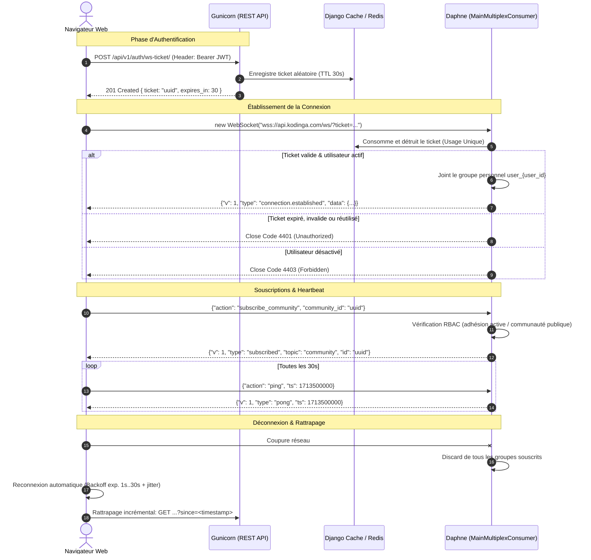

# Architecture Temps Réel (Realtime API & WebSockets)

Ce document détaille l'architecture, le cycle de vie, la sécurité, le catalogue d'événements, le déploiement et la stratégie de rollback de la couche temps réel ajoutée à Kodinga.

---

## 1. Principes Directeurs

1. **REST reste la source unique de vérité** :
   - Toute opération d'écriture (création, modification, suppression, upload de pièces jointes, pagination) s'effectue obligatoirement via l'API REST existante.
   - Les WebSockets ont un rôle **strictement descendant (push-only)** du serveur vers les clients (à l'exception des signaux éphémères comme l'indicateur d'écriture `typing` et le heartbeat `ping`/`pong`).
2. **Dégradation gracieuse sans régression** :
   - Si la couche WebSocket ou Redis tombe ou subit une coupure réseau, l'application continue de fonctionner sans interruption grâce au mécanisme de fallback REST.
   - Tout échec de diffusion sur le Channel Layer est capturé et journalisé sans impacter la transaction de base de données ni renvoyer d'erreur 500 au client REST.
3. **Zéro diffusion avant commit DB** :
   - Tout événement temps réel est obligatoirement différé via `transaction.on_commit(...)`.
   - En cas d'exception ou de rollback de transaction SQL, aucun événement n'est émis.

---

## 2. Architecture Globale

```
+-----------------------------------------------------------------------------------+
|                                  NAVIGATEUR CLIENT                                |
|   - RealtimeClient (singleton avec backoff exponentiel & jitter)                  |
|   - useRealtimeSync, useRealtimeConversation, useRealtimeCommunityFeed...         |
+--------------------------+------------------------------------+-------------------+
                           |                                    |
            REST HTTPS     |                     WebSocket WSS  |
       (Source de vérité)  |               (Evénements & Push)  |
                           v                                    v
+-----------------------------------------------------------------------------------+
|                                     NGINX                                         |
|    - /api/*  -> Proxy vers Gunicorn (WSGI) sur port 8000                           |
|    - /ws/*   -> Proxy avec Upgrade HTTP/1.1 vers Daphne (ASGI) sur port 8001      |
+--------------------------+------------------------------------+-------------------+
                           |                                    |
                           v                                    v
             +---------------------------+        +---------------------------+
             |      GUNICORN (WSGI)      |        |       DAPHNE (ASGI)       |
             |  apps.messaging, posts... |        |  realtime.consumers       |
             +-------------+-------------+        +-------------+-------------+
                           |                                    ^
                           | 1. Commit DB                       | 3. group_send
                           | 2. send_group_event                |    to clients
                           v                                    |
             +---------------------------+        +-------------+-------------+
             |     POSTGRESQL (DB)       |        |       REDIS (BROKER)      |
             | Source de vérité persistée |        |   Channels Channel Layer  |
             +---------------------------+        +---------------------------+
```

---

## 3. Cycle de Vie d'une Connexion WebSocket



---

## 4. Spécification de l'Enveloppe d'Événement v1

Tous les événements envoyés aux clients respectent une structure normalisée et versionnée :

```json
{
  "v": 1,
  "type": "nom_evenement",
  "event_id": "019485ab-c88f-7231-b841-d5b7a702b804",
  "ts": 1713500000,
  "data": { ... }
}
```

- **`v`** (integer) : Version de l'enveloppe (`1`).
- **`type`** (string) : Identifiant unique de l'événement (ex: `message.created`).
- **`event_id`** (UUID string) : Identifiant idempotent de l'événement.
- **`ts`** (integer) : Horodatage Unix en secondes au moment de la génération.
- **`data`** (object) : Données sérialisées réutilisant les serializers DRF.

---

## 5. Catalogue Complet des Événements

### 5.1. Messagerie Directe

| Type | Canal / Groupe Channels | Déclencheur | Données (`data`) |
| :--- | :--- | :--- | :--- |
| `message.created` | `conversation_{conversation_id}` | `MessagingService.send_message` | Objet sérialisé complet (`MessageSerializer`) |
| `conversation.message_preview` | `user_{participant_id}` | Nouveau message envoyé | `conversation_id`, `last_message`, `message` complet |
| `conversation.created` | `user_{participant_id}` | `MessagingService.start_direct_conversation` ou `create_group_conversation` | Objet sérialisé `ConversationListSerializer` |
| `message.updated` | `conversation_{conversation_id}` | `MessagingService.edit_message` | Objet sérialisé complet (`MessageSerializer`) |
| `message.deleted` | `conversation_{conversation_id}` | `MessagingService.delete_message` | `{"conversation_id": "uuid", "message_id": "uuid"}` |
| `message.pinned` | `conversation_{conversation_id}` | `MessagingService.toggle_message_pin` | `{"conversation_id": "uuid", "message_id": "uuid", "is_pinned": boolean}` |
| `message.read` | `conversation_{conversation_id}` | `MessagingService.mark_as_read` | `{"conversation_id": "uuid", "user_id": "uuid", "last_read_at": "ISO"}` |
| `typing.started` | `conversation_{conversation_id}` | Client via WebSocket (exclu émetteur) | `{"conversation_id": "uuid", "user": {"id": "uuid", "username": "string"}}` |
| `typing.stopped` | `conversation_{conversation_id}` | Client via WebSocket (exclu émetteur) | `{"conversation_id": "uuid", "user": {"id": "uuid", "username": "string"}}` |

### 5.2. Feed et Publications

| Type | Canal / Groupe Channels | Déclencheur | Données (`data`) |
| :--- | :--- | :--- | :--- |
| `post.created` | `community_{community_id}` | `PostService.create_post` | Objet sérialisé `PostListSerializer` |
| `post.updated` | `community_{community_id}` & `post_{post_id}` | `PostService.update_post` | Objet sérialisé `PostDetailSerializer` |
| `post.deleted` | `community_{community_id}` & `post_{post_id}` | `PostService.delete_post` | `{"community_id": "uuid", "post_id": "uuid"}` |
| `post.pinned` | `community_{community_id}` | `PostService.toggle_post_pin` | `{"community_id": "uuid", "post_id": "uuid", "is_pinned": boolean}` |
| `post.locked` | `community_{community_id}` & `post_{post_id}` | `PostService.toggle_post_lock` | `{"community_id": "uuid", "post_id": "uuid", "is_locked": boolean}` |
| `post.reaction` | `community_{community_id}` & `post_{post_id}` | `PostService.toggle_post_reaction` | `{"community_id": "uuid", "post_id": "uuid", "reaction_type": "string", "reactions_count": int, "user_id": "uuid", "action": "added"\|"removed"}` |

### 5.3. Fil de Commentaires

| Type | Canal / Groupe Channels | Déclencheur | Données (`data`) |
| :--- | :--- | :--- | :--- |
| `comment.created` | `post_{post_id}` | `PostService.create_comment` | Objet sérialisé `CommentSerializer` |
| `post.comments_count` | `community_{community_id}` | Création ou suppression de commentaire | `{"community_id": "uuid", "post_id": "uuid", "comments_count": int}` |
| `comment.updated` | `post_{post_id}` | Édition d'un commentaire | Objet sérialisé `CommentSerializer` |
| `comment.deleted` | `post_{post_id}` | `PostService.delete_comment` | `{"post_id": "uuid", "comment_id": "uuid"}` |
| `comment.accepted` | `post_{post_id}` | `PostService.mark_accepted_answer` | `{"post_id": "uuid", "comment_id": "uuid", "is_accepted": boolean}` |
| `comment.reaction` | `post_{post_id}` | `PostService.toggle_comment_reaction` | `{"post_id": "uuid", "comment_id": "uuid", "reaction_type": "string", "reactions_count": int, "user_id": "uuid", "action": "added"\|"removed"}` |

### 5.4. Notifications

| Type | Canal / Groupe Channels | Déclencheur | Données (`data`) |
| :--- | :--- | :--- | :--- |
| `notification.created` | `user_{recipient_id}` | `NotificationService.create_notification` | Objet sérialisé `NotificationSerializer` |

---

## 6. Sécurité et Contrôle d'Accès

1. **Pas de JWT dans l'URL de connexion WebSocket** :
   - Les URLs contenant des JWT posent des risques majeurs de fuite dans les logs des reverse proxies, historiques de navigateur et en-têtes Referrer.
   - Kodinga utilise un ticket d'authentification éphémère (TTL 30 secondes), obtenu par un appel authentifié `POST /api/v1/auth/ws-ticket/`.
   - Ce ticket est consommé de façon atomique (`delete` immédiat) dès la première connexion.
2. **Autorisations dynamiques à la souscription (RBAC)** :
   - L'accès à `community_{id}` et `post_{id}` vérifie que la communauté est publique ou que l'utilisateur possède une adhésion active (`MembershipStatus.ACTIVE`).
   - L'accès à `conversation_{id}` vérifie que l'utilisateur est bien participant de la conversation.
   - Les superadmins ont un droit d'accès universel.
3. **Suppression de l'écho** :
   - Pour les signaux comme `typing`, le `sender_channel` est exclu du broadcast pour ne pas polluer l'émetteur.
4. **Rate limiting intégré** :
   - Les indicateurs d'écriture sont bridés à 1 événement par seconde par conversation et par utilisateur pour protéger le Channel Layer.

---

## 7. Guide de Déploiement en Production

### 7.1. Variables d'Environnement

Dans `deploy/api.env` :

```env
# Activation du backend Channel Layer Redis
REDIS_URL=redis://redis:6379/1

# Port ASGI Daphne
DAPHNE_PORT=8001
```

Dans les variables d'environnement du Frontend web :

```env
# Optionnel (par défaut, dérivé automatiquement de l'URL d'API)
VITE_WS_URL=wss://api.kodinga.com/ws/
```

### 7.2. Configuration Nginx

Dans le fichier de configuration Nginx du serveur :

```nginx
# Proxy des requêtes REST vers Gunicorn
location /api/ {
    proxy_pass http://127.0.0.1:8000;
    proxy_set_header Host $host;
    proxy_set_header X-Real-IP $remote_addr;
    proxy_set_header X-Forwarded-For $proxy_add_x_forwarded_for;
    proxy_set_header X-Forwarded-Proto $scheme;
}

# Proxy des WebSockets vers Daphne
location /ws/ {
    proxy_pass http://127.0.0.1:8001;
    proxy_http_version 1.1;
    proxy_set_header Upgrade $http_upgrade;
    proxy_set_header Connection "upgrade";
    proxy_set_header Host $host;
    proxy_set_header X-Real-IP $remote_addr;
    proxy_set_header X-Forwarded-For $proxy_add_x_forwarded_for;
    proxy_set_header X-Forwarded-Proto $scheme;
    proxy_read_timeout 86400s;
    proxy_send_timeout 86400s;
}
```

### 7.3. Démarrage Docker Compose

```bash
docker compose up -d redis asgi api
```

---

## 8. Procédure de Rollback

En cas d'incident ou de panne imprévue sur le service Daphne ou Redis en production :

1. **Rollback immédiat sans coupure de service (Zéro Downtime)** :
   - Éteindre le conteneur Daphne (`docker compose stop asgi`).
   - Le frontend web détecte automatiquement la perte de connexion WebSocket et bascule en douceur sur le mode polling de secours (`MESSAGES_POLLING`, `CONVERSATIONS_POLLING`).
   - Toutes les opérations de lecture et d'écriture REST continuent de fonctionner à 100%.
2. **Désactivation côté Nginx** :
   - Commenter le bloc `location /ws/` dans `nginx.conf` et recharger (`nginx -s reload`).
3. **Absence d'impact sur la base de données** :
   - Les tables PostgreSQL n'ont subi aucune migration destructive : aucune migration de rollback DB n'est nécessaire.

---

## 9. Métriques et Supervision

À surveiller en production :

- **Redis Memory & Connections** :
  ```bash
  redis-cli -u redis://localhost:6379/1 info memory
  redis-cli -u redis://localhost:6379/1 client list
  ```
- **Nombre de connexions actives Daphne** :
  - Métrique de sockets TCP ouvertes sur le port 8001.
- **Logs applicatifs realtime** :
  - Surveiller le logger `"kodinga.realtime"` dans les logs Docker.
  - Alertes sur `[REALTIME BROADCAST ERROR]` ou codes de rejet inhabituels.
